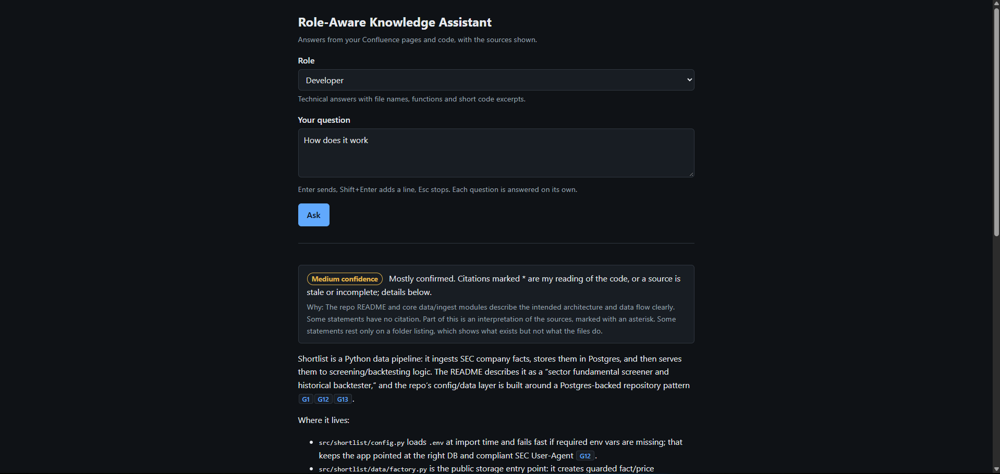
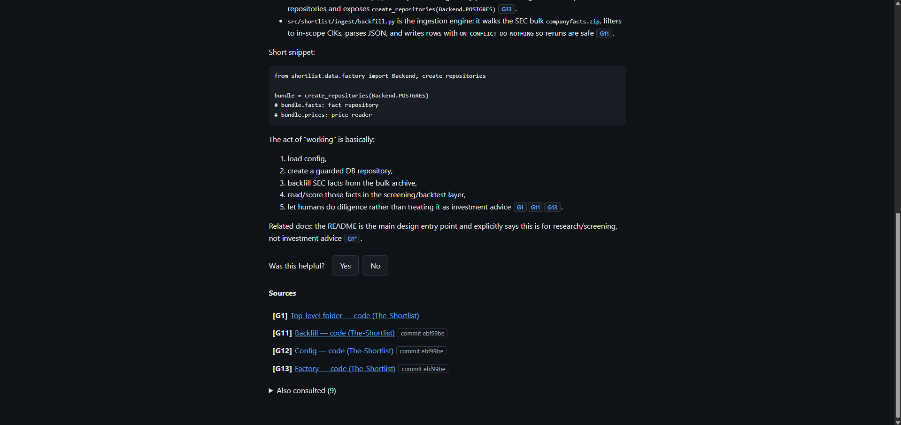
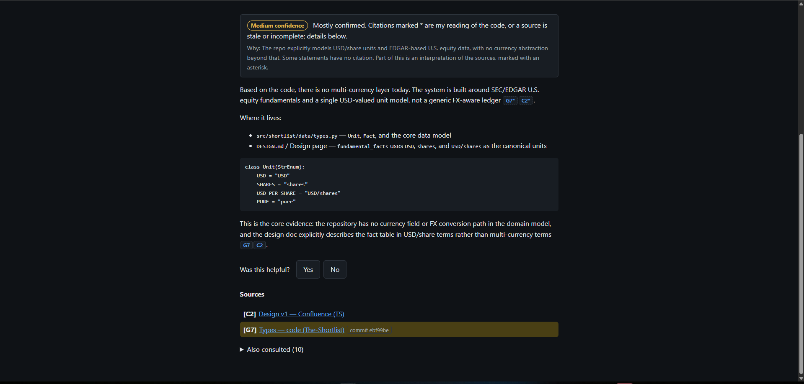
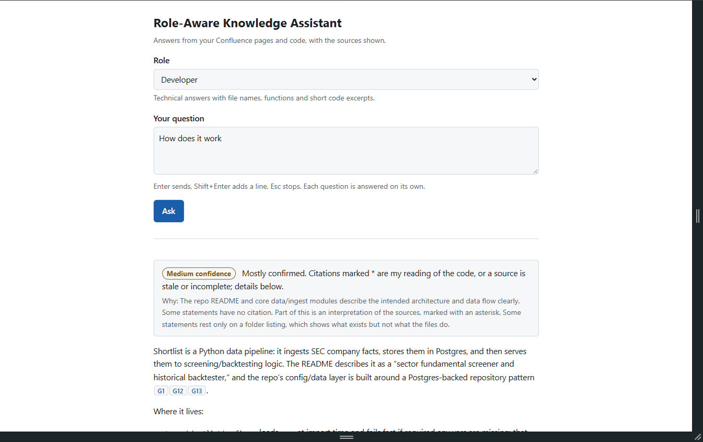
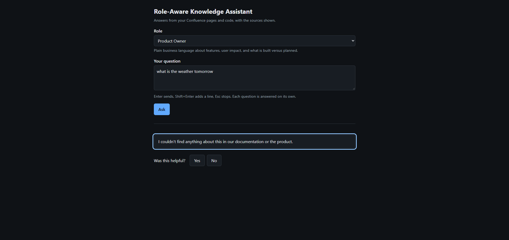
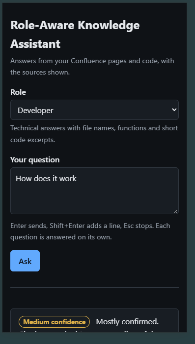

# Role-Aware Knowledge Assistant

A local, role-aware RAG assistant. A user picks a role (Developer, BA, QA, Product Owner,
Project Manager), asks a question, and the app answers from Confluence and GitHub through MCP
servers, using GitHub Copilot as the reasoning layer. Every answer cites the pages and files it
used and states how confident it is.

It runs on one machine, for one person, and everything it does against Confluence and GitHub is
read-only. The project was built in phases (see [docs/ROADMAP.md](docs/ROADMAP.md)): quality gates
and config, the Copilot and MCP connection, roles and citations, the honesty checks, the local web
page, and last an evaluation (see [Evaluation](#evaluation)). The change history is in
[CHANGELOG.md](CHANGELOG.md) and a ten-minute walkthrough is in [docs/DEMO.md](docs/DEMO.md).

## Quickstart

1. `npm ci`
2. `cp .env.example .env`, then fill in the GitHub and Atlassian values
   ([Environment variables](#environment-variables), [Atlassian access](#atlassian-access)).
3. Sign in to Copilot, for example with `gh auth login` ([Copilot login](#copilot-login)).
4. `npm start`
5. Open `http://127.0.0.1:3000`, pick a role and ask a question.

## How it fits together

```
  Browser (public/)             Command line (npm run ask / npm run eval)
        |  SSE stream                         |
        v                                     v
  Fastify server (src/server) ------> askQuestion (src/answer)
  local-only guards, CSP                      |
                                              v
                      Copilot SDK session (src/copilot) + role block (roles/*.yaml)
                                              |
                  tool calls pass through hooks (src/mcp): allow-list, scope, call limit
                         |                                              |
                         v                                              v
            Atlassian MCP server                               GitHub MCP server
            (Confluence pages, read-only)                    (files, commits, releases, read-only)
                         |                                              |
                         +------------- results become sources ---------+
                                              |
                                              v
            citations (src/citations): keys C1, G1..., pinned links
            honesty   (src/honesty):   status, confidence caps, gaps, conflicts, who to ask
            style     (src/style):     one rewrite when the answer does not suit the role
```

The model never sees a write tool, and it never decides what counts as a source or how sure the
answer is: the application does both, from what the tools actually returned.

## Requirements

- Node.js `^22.22.2 || >=24.15.0`. `.nvmrc` pins Node 24, so `nvm use` picks the right one.
- npm (ships with Node).
- Docker, only if you want the SonarQube MCP server for Claude Code (see below).

## Setup

```bash
npm ci
cp .env.example .env   # then fill in real values
npm start
```

`npm start` loads `.env` if it exists, validates the settings, starts Copilot and serves the web page on
`http://127.0.0.1:3000` (`HOST`, `PORT`), logging one startup line with the
secrets masked. If a variable is missing or invalid, it prints which one and exits with code 1.
Values already exported in your shell win over `.env`.

## Scripts

| Script                                                     | What it does                                                                                                   |
| ---------------------------------------------------------- | -------------------------------------------------------------------------------------------------------------- |
| `npm start`                                                | Start the web server (`src/server/index.js`)                                                                   |
| `npm run dev`                                              | Same, restarting when a file under `src/` changes                                                              |
| `npm run lint`                                             | ESLint with JSDoc and SonarJS rules; zero warnings allowed                                                     |
| `npm run lint:fix`                                         | ESLint with auto-fix                                                                                           |
| `npm run format`                                           | Prettier, write                                                                                                |
| `npm run format:check`                                     | Prettier, check only                                                                                           |
| `npm run typecheck`                                        | `tsc --noEmit` over the JSDoc types (`jsconfig.json`)                                                          |
| `npm test`                                                 | Vitest, once                                                                                                   |
| `npm run test:watch`                                       | Vitest in watch mode                                                                                           |
| `npm run test:coverage`                                    | Vitest with coverage; fails below 90% for lines, branches, functions and statements                            |
| `npm run ask -- [--role <id>] [--json] "<question>"`       | Ask a question as a role; prints the answer with its confidence, sources and tools used, or the result as JSON |
| `npm run roles`                                            | List the role profiles in `roles/`                                                                             |
| `npm run models`                                           | List the models your Copilot account can use                                                                   |
| `npm run mcp:tools`                                        | List both MCP servers' tools and write `docs/mcp-tools.md`                                                     |
| `npm run mcp:sample -- <tool> '<json args>' [--as <name>]` | Call one allow-listed tool and save its raw result to `test/fixtures/raw/` (git-ignored)                       |
| `npm run fixtures:sanitise`                                | Turn the raw samples into `test/fixtures/mcp/*.json` with no real names or content                             |
| `npm run test:live`                                        | Live tests against real Copilot, Confluence and GitHub (needs a filled-in `.env`)                              |
| `npm run eval -- [options]`                                | Run the eval set through the real pipeline (see [Evaluation](#evaluation))                                     |
| `npm run eval:review -- <run>`                             | Write `review.csv` for a run, for manual verdicts                                                              |
| `npm run eval:report -- <run> [--compare <run>]`           | Merge the verdicts and write `report.md`: correctness, calibration, targets                                    |
| `npm run eval:from-feedback`                               | Turn thumbs-down feedback into draft eval cases                                                                |
| `npm run verify`                                           | lint, format check, typecheck and coverage in sequence; stops at the first failure                             |

Run `npm run verify` before every commit and PR.

## Environment variables

Only `src/config` reads the environment. Everything else receives the validated config object.
Invalid values are reported by variable name, never by value.

| Variable                | Required | Default       | Rule                                                                      |
| ----------------------- | -------- | ------------- | ------------------------------------------------------------------------- |
| `NODE_ENV`              | no       | `development` | `development`, `test` or `production`                                     |
| `LOG_LEVEL`             | no       | `info`        | `fatal`, `error`, `warn`, `info`, `debug`, `trace`, `silent`              |
| `PORT`                  | no       | `3000`        | Integer from 1 to 65535                                                   |
| `HOST`                  | no       | `127.0.0.1`   | Address the web server listens on; non-loopback needs `ALLOW_REMOTE=true` |
| `ALLOW_REMOTE`          | no       | `false`       | `true` lets `HOST` be a non-loopback address; the server has no login     |
| `GITHUB_TOKEN`          | yes      |               | Fine-grained PAT with read-only Contents and Metadata on the listed repos |
| `GITHUB_REPOS`          | yes      |               | Comma-separated `owner/repo` list, at least one                           |
| `ATLASSIAN_SITE_URL`    | yes      |               | `https://<site>.atlassian.net`; a trailing slash is removed               |
| `ATLASSIAN_CLOUD_ID`    | no       |               | Site cloudId (UUID); when set it is used on every Confluence call         |
| `ATLASSIAN_AUTH_MODE`   | no       | `basic`       | `basic` (personal API token) or `bearer` (service-account API key)        |
| `ATLASSIAN_EMAIL`       | basic    |               | Email of the account that owns the API token; not used in `bearer` mode   |
| `ATLASSIAN_API_TOKEN`   | yes      |               | Atlassian API token or service-account API key (see Atlassian access)     |
| `CONFLUENCE_SPACE_KEYS` | yes      |               | Comma-separated space keys, at least one                                  |
| `COPILOT_MODEL`         | no       | none          | Non-empty model name when set; unset uses your account's default          |
| `COPILOT_GITHUB_TOKEN`  | no       | none          | Credential for Copilot only; unset uses your logged-in user (see below)   |
| `ASK_TIMEOUT_MS`        | no       | `120000`      | Integer from 5000 to 600000; a slower question is aborted (exit code 2)   |
| `MAX_TOOL_CALLS`        | no       | `12`          | Integer from 1 to 50; further tool calls in one question are denied       |
| `MCP_TIMEOUT_MS`        | no       | `30000`       | Integer from 1000 to 120000; limit for one call to an MCP server          |

### Atlassian access

Which mode to use depends on the kind of credential:

| Credential              | `ATLASSIAN_AUTH_MODE` | `ATLASSIAN_EMAIL` | Header sent                 |
| ----------------------- | --------------------- | ----------------- | --------------------------- |
| Personal API token      | `basic` (default)     | required          | `Basic base64(email:token)` |
| Service-account API key | `bearer`              | not used          | `Bearer <key>`              |

- A service account needs Confluence product access and **view** permission on every space listed
  in `CONFLUENCE_SPACE_KEYS`, or its searches return nothing.
- The organization setting "Allow API token authentication" must be on for the Rovo MCP server.
- The token needs the scopes the Rovo MCP server asks for: `read:me` and `read:account` (to find
  the site), `search:confluence:agent-interface` and `read:confluence:agent-interface`.
- When a tool call fails, the first 300 characters of the error are logged with secrets masked, so
  a scope or permission problem shows up in the log.

### Copilot login

Copilot is the reasoning layer and needs its own credential, separate from the read-only tokens
above. Any one of these works:

- `gh auth login`, if you already use the GitHub CLI (the runtime falls back to `gh auth token`);
- `copilot login`, which stores the login in your system keychain;
- `COPILOT_GITHUB_TOKEN` in `.env`: a fine-grained personal access token with the "Copilot
  Requests" account permission. Classic `ghp_` tokens are not supported by Copilot.

**Never reuse `GITHUB_TOKEN` for Copilot.** The app removes it, `GH_TOKEN` and every other app
setting from the Copilot runtime's environment, so the MCP token cannot become the Copilot
credential by accident. A login stored in plaintext in `~/.copilot/config.json` is not found,
because the runtime runs against a throwaway data directory; use one of the three options above.

`npm run models` is a quick check that you are signed in. Some plans, such as Copilot Free, report
no models; leave `COPILOT_MODEL` unset to use the default.

### Using the web page

```bash
npm start      # serves the page on http://127.0.0.1:3000 (change it with PORT)
npm run dev    # the same, restarting when a file under src/ changes
```

Open `http://127.0.0.1:3000`. `npm start` loads `.env`, starts Copilot, checks you are signed in
and then listens; a bad setting or a missing Copilot login prints one message and exits with
code 1. Ctrl+C stops the server, any question that is running, and Copilot.

On the page you pick a role (your choice is remembered in the browser) and type a question. Enter
sends, Shift+Enter adds a line and Esc stops. While it works you see progress lines such as
"Searching Confluence…" and the draft answer as plain grey text; the draft is not checked yet. When
the answer has been checked it replaces the draft with:

- a **banner** with the confidence level in words ("Medium confidence") and why;
- the answer, with **citation chips** (`C1`, `G2*`). Click a chip to jump to its source in the
  Sources list; a chip with `*` is the assistant's own reading of the code;
- where the documentation and the code disagree, **What I couldn't confirm**, and **Who might
  know**;
- a **Sources** list with links (Confluence pages, files pinned to a commit), tags such as "may be
  out of date", and a collapsed **Also consulted** list;
- **Show more detail**, which asks the same question again one step more technically (not offered
  to the Developer role, or when the answer was not found);
- **Yes / No** feedback. A No opens a box for a comment and the source that was wrong.





Clicking a chip highlights its source:



The page follows the browser's light or dark setting and works on a narrow screen. When nothing is
found, the role's own wording is shown instead of an answer:







**Stop** cancels the question: the server aborts the Copilot session, and the log shows
`the question was cancelled; aborting the session`. One question is answered at a time; a second
one gets a "please wait" message.

Feedback is appended, one JSON line each, to `data/feedback.jsonl` (git-ignored, created on first
use): the time, question, role, detail level, status, confidence, cited keys, rating, comment,
wrong-source key and model. It never holds the answer text or a token.

#### Security model of the web server

The page has no login, so it is built to be reachable only from the machine it runs on.

- **Loopback only.** The server listens on `127.0.0.1` (`HOST`). A `HOST` that is not a loopback
  address makes it refuse to start unless `ALLOW_REMOTE=true`. **Do not set `ALLOW_REMOTE`**
  unless the network is one you trust completely: anyone who can reach the port can ask questions
  with your Copilot, Confluence and GitHub access.
- **Every `/api/*` request is checked.** The `Host` must be `127.0.0.1:<port>` or
  `localhost:<port>` (against DNS rebinding); a request that changes something must send
  `Content-Type: application/json`; an `Origin` header, when there is one, must be the server's
  own; and a `Sec-Fetch-Site: cross-site` request is refused. A refusal is a 403 with a short JSON
  message, logged at warn with only the reason. No CORS headers are sent, so other sites cannot
  read the responses.
- **Headers.** `Content-Security-Policy: default-src 'self'; img-src 'self' data:; style-src
'self'; script-src 'self'; frame-ancestors 'none'; base-uri 'none'`, `X-Content-Type-Options:
nosniff`, `Referrer-Policy: no-referrer`; API responses are `no-store`. The page has no inline
  script or style.
- **Model text is data.** The server turns the answer's markdown into HTML with `marked`, shows raw
  HTML in it as text, and sanitises the result with `sanitize-html`. A link in an answer is kept
  only if it is `https` and points to your Atlassian site or `github.com`; any other link is shown
  as text. The page puts only that HTML in the document and writes streamed text, source titles
  and everything else as text.
- **Small surface.** The request body is limited to 16 KB; only the files in `public/` are served,
  by an allow-list built at start; feedback is accepted only for an answer id the server handed
  out.

#### API

| Route                | What it does                                                                                                                                                                                                                                                                                                                                                                                                                                                    |
| -------------------- | --------------------------------------------------------------------------------------------------------------------------------------------------------------------------------------------------------------------------------------------------------------------------------------------------------------------------------------------------------------------------------------------------------------------------------------------------------------- |
| `GET /api/health`    | `{ "status": "ok" }`                                                                                                                                                                                                                                                                                                                                                                                                                                            |
| `GET /api/roles`     | `[{ id, displayName, description, depth }]`                                                                                                                                                                                                                                                                                                                                                                                                                     |
| `POST /api/ask`      | Body `{ question, role, detailLevel }` (`detailLevel` is `default` or `more`). Answers with a `text/event-stream` of `progress` `{ kind, message }`, `token` `{ text }` (the `answer-meta` block is never in it), then exactly one `done` or `error`. `done` holds `{ answerId, result, rendered, html: { answer, conflicts } }`; `error` holds `{ kind, message }` with kind `timeout`, `cancelled`, `copilot` or `internal`. 429 while another question runs. |
| `POST /api/feedback` | Body `{ answerId, rating: "up" or "down", comment?, wrongSourceKey? }`; 404 for an unknown id, 400 for a source the answer did not cite.                                                                                                                                                                                                                                                                                                                        |

### Asking a question

```bash
npm run ask -- "How does the checkout flow work in the shop-api repo?"
npm run ask -- --role product_owner "What does the refund feature do?"
```

`--role` picks who the answer is written for (default `developer`). The command prints a progress
line to stderr, then, once the answer has been checked: a banner with the confidence level (for
example `[medium] Mostly confirmed…`), the answer, where the documentation and code disagree, **What
I couldn't confirm**, a numbered **Sources** list, **Also consulted**, **Who might know**, a "Tools
used" list (server, tool, a short argument summary and duration; never secrets or page content)
and the role, model and time taken. See [Honesty and confidence](#honesty-and-confidence) for what
each part means. Logs go to stderr as JSON.

`--json` prints the whole result as JSON instead (status, confidence, `confidenceReason`,
`capsApplied`, sources and the rest), which is what the later web UI and the evaluation work use.

Exit codes: `0` for every status, because "not found" and "out of scope" are correct outcomes, not
errors; `1` for a missing question, an unknown role, bad config, no Copilot login or a Copilot
error (one line on stderr); `2` when the question exceeds `ASK_TIMEOUT_MS`.

### Roles

`npm run roles` lists the profiles in [roles/](roles). There are five: `developer`,
`business_analyst`, `qa`, `product_owner` and `project_manager`. Each is a YAML file checked at
startup (a bad file names the file and field). A profile sets the audience, a depth from 1 to 3,
the vocabulary to use and the words to avoid, which source to search first, the shape of the answer
and examples. All roles are grounded the same way: the part of the system message about grounding,
safety and citations is identical for every role, and only the role block changes how the answer
is written. Depth 1 roles (product owner, project manager) get plain business language, with no
code or file paths in the answer or the Sources list.

A role can also reword the banners the application shows when it is unsure, under `phrases` in its
YAML file. Any of `high`, `medium`, `low`, `notFound` and `outOfScope` can be set; one left out uses
the default. Each is a single line of at most 200 characters, and an unknown name is refused.
Raise the role's `version` by one when you change it.

```yaml
phrases:
  low: "I'm not sure. Here's what I found and what's still unclear."
  notFound: "I couldn't find anything about this in our documentation or the product."
```

Wording changes how uncertainty is said, never whether it is said: the banner, level and lists are
added by the application, not written by the model.

### How citations work

- Every page or file the model reads is given a key: `C1`, `C2`… for Confluence pages, `G1`, `G2`…
  for GitHub files, folders, commits and releases. The tool result is wrapped in a
  `<source key="…">` tag, and any `<source` text inside the content is defused so content cannot
  claim a key.
- The model cites with `[C1]` or `[C1][G2]` after a sentence. After the answer, the app checks
  every key. A key that was never given out is removed from the text and reported, not shown as a
  citation.
- The **Sources** list is built by the app, never by the model. A Confluence entry links to the
  page and records its version (and notes a page not updated in over a year). A GitHub entry is
  pinned to a 40-character commit SHA, so the link keeps showing what the model saw. The commit
  comes from the result itself or from the repository's head commit; if neither is found the link
  is to the default branch and says it is not pinned.
- Search hits and commit lists (`searchConfluence`, `search_code`, `list_commits`) are not
  sources: they appear under **Also consulted** and cannot be cited. The list of releases
  (`list_releases`) is a source, linked to the repository's releases page and pinned to its head
  commit when that can be found; each release in it is also listed under **Also consulted**.
- A folder listing is a source for which files and folders exist, not for what is inside a file. A
  sentence that rests only on one gets an asterisk from the application and counts as the model's
  reading (see [Honesty and confidence](#honesty-and-confidence)).
- Confluence content that is not in `CONFLUENCE_SPACE_KEYS`, or whose space cannot be determined,
  is replaced by a notice before the model sees it. If the check itself fails, the content is
  replaced too.
- Each question gets two `search_code` calls. An empty code search tells the model to browse
  folders instead.
- Large results: the Copilot runtime's own "large output" handling is turned off, because it hides
  a long page behind a file pointer the model cannot read. Instead a Confluence page is given to
  the model as plain text (headings kept, markup and attributes dropped, which makes a long page
  about a third shorter), and every source is cut at 60,000 characters. When something is cut, the
  model is told, and for a page it is given the headings of the sections that were cut so it can
  report them as unchecked.
- Set `ATLASSIAN_CLOUD_ID` to save the model two calls: it is then used for every Confluence call.

### Honesty and confidence

Every answer says how sure it is and why. The model reports a status and a level at the end of its
reply, in a fenced block tagged `answer-meta`; the application checks the block, removes it (it is
never shown) and has the final say, through caps the model cannot override. A reply with no valid
block counts as low confidence ("The assistant did not report its confidence") — but first the
model is asked once more, with every tool locked, for the block alone, and the answer text is never
changed (see below). Text after the block is kept and a warning is logged.

**Statuses.** Every result has one:

| Status         | Meaning                              | What is shown                                                |
| -------------- | ------------------------------------ | ------------------------------------------------------------ |
| `answered`     | The sources answer the question      | Banner with level, answer, sources, and the lists below      |
| `not_found`    | Nothing in the sources answers it    | The role's not-found text, the closest pages, who might know |
| `clarify`      | The question fits two or more things | One short question, nothing else                             |
| `out_of_scope` | The sources can never answer it      | The role's out-of-scope text, no sources                     |

The model's own text is discarded for `not_found` and `out_of_scope`. An `answered` reply with no
valid citation at all becomes `not_found`, whatever the model said.

**Confidence levels and caps.** The model proposes `high`, `medium` or `low` with a reason. The
application can only lower it, and each rule that holds adds a sentence to `confidenceReason` and an
entry to `capsApplied` in the JSON:

| Code                | When                                                      | Limit     |
| ------------------- | --------------------------------------------------------- | --------- |
| `no-citations`      | No citation in the answer is a real, fetched source       | not found |
| `invalid-keys`      | The model used a citation key it was never given          | medium    |
| `uncited-sentences` | A sentence makes a claim without a citation (a heuristic) | medium    |
| `stale-page`        | A cited Confluence page was last updated over a year ago  | medium    |
| `inferred`          | A citation carries an asterisk (see below)                | medium    |
| `folder-only`       | A sentence rests only on a folder listing                 | medium    |
| `gaps`              | The model listed things it could not confirm              | medium    |
| `conflicts`         | The documentation and the code disagree                   | low       |
| `no-meta`           | The model's report is missing or invalid                  | low       |

**Stated and inferred.** A sentence that repeats a source gets a normal citation, `[C1]`. A sentence
that is the model's interpretation, usually of code, starts "Based on the code, it looks like…" and
marks its citation with an asterisk, `[G1*]`. The asterisk stays in the answer, the source gets
`inferred: true` when every citation of it has one, and the sources list says "my reading of it". A
folder listing shows what exists, not what the files do, so a sentence supported only by one gets
the asterisk added by the application. This closes the gap where a claim about a file's contents
could be cited to a directory listing.

**Gaps and conflicts.** At medium and low confidence the answer ends with **What I couldn't
confirm**. When the documentation and the code disagree, the application writes both sides itself
("The documentation says X [C1]; the code does Y [G2]. The code reflects current behaviour."),
so the model cannot soften or settle it. The keys in a conflict are checked like any other.

**Who might know.** For `not_found` and for medium and low answers, the application suggests, with
no extra model call: the owners of the files and folders the model read, from the repository's
`CODEOWNERS` (`.github/CODEOWNERS`, `CODEOWNERS` or `docs/CODEOWNERS`, read once per repository,
allowed repositories only), and whoever last saved a Confluence page when the page result names
them. The Atlassian server used so far returns only an account id, so page editors rarely appear.
Names are never logged.

**Style check and one rewrite.** After the answer is checked, `checkStyle` compares it with the
role: depth 1 allows no code blocks, inline code, file paths or banned words; depth 2 no code
blocks or banned words; depth 3 only banned words. If it fails, the model is asked once, in the
same session, to rewrite the answer, with every tool locked. The rewrite is used only if it still
cites exactly the same sources, keeps every asterisk and is still an answer, and it can never make
the answer more confident. Otherwise the first answer is kept and the result says why
(`rewriteRejectedReason`: `citations`, `markers`, `status`, `timeout` or `error`). `ask` prints a
short note on stderr when a rewrite happened or was refused.

**A missing report, asked for again.** When the reply has an answer but no usable `answer-meta`
block, the model is asked once, in the same session and with tools locked, for the block alone. Only
the validated block is taken from that reply, so the answer text stays the first reply's, and the
repaired report goes through every cap above. The result says so (`metaRepaired`, or
`metaRepairRejected` with a reason, if no usable block came back). A reply that is not an answer
(not found, out of scope, a clarifying question) may leave the reason out of its block: it then
gets a fixed sentence for its status. An answered reply must still give a reason.

**Known limits.**

- The status is the model's call. The caps limit how sure an answer may sound, but they cannot
  turn a wrong status into the right one: in the evaluation the model still answered a question
  that asks for a fact the sources do not hold (it described something similar instead), and
  answered one reading of two questions that should have been clarified.
- The uncited-sentence check is a heuristic. A paragraph of up to three sentences whose last
  sentence cites a source counts as cited; in a longer paragraph a sentence whose citation sits
  elsewhere counts as uncited.
- Confidence was measured on a small sample (see [Evaluation](#evaluation)); treat the levels as
  a guide, not a probability.

### Test fixtures

The extractors that read MCP results are built on real tool results with the content removed.
`npm run mcp:sample` calls one allow-listed tool (through the same scope check as the assistant) and
saves the raw result under `test/fixtures/raw/`, which is git-ignored. `npm run fixtures:sanitise`
rewrites those into `test/fixtures/mcp/*.json`: names, sites, spaces and URLs are mapped to
placeholders, text and code are replaced, and the command fails, naming the file and the kind of
leak, if any real name, email or account id is left. Review the sanitised files before committing
them. `search_code.synthetic.json` is hand-written, because the real search returned no hits for
the repository used; it is marked as synthetic.

### How read-only is enforced

Everything the assistant does against Confluence and GitHub is read-only, by several independent
layers; each one alone would stop a write.

1. **Allow-list.** [src/mcp/allowlist.js](src/mcp/allowlist.js) names the only tools Copilot may
   use: Confluence `searchConfluence`, `getConfluenceContent` and
   `getAccessibleAtlassianResources`, and GitHub `search_code`, `get_file_contents`,
   `get_commit`, `list_commits`, `list_releases` and `get_latest_release`. The list is sent to
   each server and as the session's exact tool list; every built-in tool (shell, files, URLs) is
   excluded. The GitHub server is also asked for read-only mode and the `repos` toolset only.
2. **Scope hooks.** Before each call a hook denies it unless the repository is in `GITHUB_REPOS`
   (and `search_code` has a `repo:` qualifier for one), and the Confluence query or page URL stays
   within `CONFLUENCE_SPACE_KEYS` and the configured site. It also enforces `MAX_TOOL_CALLS`. Hooks
   fail closed: a hook that throws, or cannot check a call, denies it.
3. **Permission handler.** Deny by default: it approves only an MCP call to an allow-listed tool and
   rejects every other kind of request (shell, write, read, url, memory and the rest).
4. **Sandbox.** The Copilot runtime starts in an empty temporary directory with a filtered
   environment, removed afterwards.

Tool results are treated as data, never as instructions. Tests cover each layer; `npm run test:live`
checks the allow-list against the real servers and that a request to change a repository makes no
write call.

**Jira:** the Atlassian allow-list is Confluence-only, with no Jira tools even read-only. Rovo's
generic `search` tool is left out on purpose because it can surface Jira results and cannot be
limited to a space.

### Pinned Copilot SDK

`@github/copilot-sdk` is pinned to exactly **1.0.19** (no `^` range). It releases almost daily and
the safety checks above depend on its behaviour (tool filtering, hooks, permission requests). To
upgrade, change the version on purpose, re-read its type definitions and run `npm run verify` and
`npm run test:live`.

`.env` is git-ignored. `.env.example` lists every variable with a placeholder and says where to
create each token.

## Project layout

```
src/
  answer/    askQuestion: runs one question through Copilot; validated result, report, argument parsing
  citations/ source registry, wrapping, labels, citation checking, extractors for each tool result
  cli/       ask, roles, models, mcp:tools, mcp:sample, fixtures:sanitise and eval commands (wiring only)
  config/    validated config loader (loadConfig, redactConfig, buildRuntimeEnv)
  copilot/   Copilot client, session config and system message (shared base plus role block)
  errors/    AppError and its subclasses
  eval/      the evaluation: case loading, scoring, request budget, runner, review sheet, report
  fixtures/  the fixture sanitiser and its leak check
  github/    read-only GitHub REST client; head-commit lookup to pin links; CODEOWNERS reader
  honesty/   answer-meta parsing, confidence caps, uncited-sentence check, who to ask, final rendering
  logger/    pino logger factory with secret redaction
  mcp/       server config, tool allow-list, scope and post-tool hooks, permission handler, discovery
  roles/     role schema and loader (profiles are in the top-level roles/ folder)
  style/     checks an answer against what its role allows
  server/    the web server: Fastify app, guards, security headers, SSE, feedback; index.js starts it
  render/    answer markdown to safe HTML with citation chips; removes answer-meta from the stream
eval/        questions.example.yaml (committed); your real questions.yaml and the results/ are git-ignored
public/      the web page: index.html, css/ and vanilla JavaScript modules in js/ (no build step)
test/        mirrors src/ and public/js/; test/helpers holds shared test utilities; test/live runs on demand
docs/        roadmap, system design, coding principles and one file per phase
```

Each folder under `src/` has an `index.js` that is its only public entry point. The rules for
writing code here are in [docs/CODING_PRINCIPLES.md](docs/CODING_PRINCIPLES.md).

## Evaluation

The assistant is measured against a set of real questions, with the answers checked by hand. The
set (`eval/questions.yaml`) and every run (`eval/results/`) describe your own project, so both are
git-ignored; `eval/questions.example.yaml` shows the format with an invented project.

```bash
npm run eval -- --subset smoke                 # the cases tagged smoke
npm run eval -- --ids case-a,case-b            # chosen cases (add --subset smoke to include the smoke ones)
npm run eval -- --subset full --max-requests 60
npm run eval:review -- <run-folder>            # writes review.csv: fill in verdict (correct, partial, wrong)
npm run eval:report -- <run-folder> --compare <earlier-run-folder>
npm run eval:from-feedback                     # thumbs-down answers become draft cases
```

- A case names a role, a question, the expected status and sources, and a short reference answer.
  The runner refuses a case still marked `draft: true`.
- `eval` prints the number of cases and the Copilot requests it expects, and asks before it starts
  (`--yes` skips the question). `--max-requests` stops cleanly when reached. It stops on Ctrl+C
  and keeps what finished.
- Each run writes `results.jsonl` and `summary.md`, and records the commit, the model asked for
  and the models that answered, each role's version and a hash of the shared prompt, so two runs
  can be compared knowing what differs.
- The automatic checks cover exact and lenient status, citation recall, forbidden sources,
  confidence caps, style, missing reports, invented keys, uncited sentences and time. Correctness
  and calibration come only from the verdicts you give; there is no model judging another model.
- Asking the same question twice does not always give the same result, so a change counts as an
  improvement only when it beats the variation measured at baseline.

**What was measured.** [docs/EVAL_LOG.md](docs/EVAL_LOG.md) has the numbers: a baseline over 38
questions, two tuning rounds with their before and after, and what each change did not fix.
**The planned final full run was not done**, because it would have used up the Copilot allowance;
the last numbers are for the 20-question subset that the tuning rounds used, and the MVP targets
are judged against the baseline in the log, with that stated.

## Limitations

- **One person, one machine.** The web server has no login and listens only on the local machine
  unless you set `ALLOW_REMOTE=true`, which is not advised. Credentials come from `.env`.
- **No memory.** Each question is answered on its own; nothing is kept between questions except
  the thumbs-up and thumbs-down you record (`data/feedback.jsonl`, no answer text).
- **Code search depends on GitHub's index.** `search_code` may return nothing for a repository;
  the assistant then browses folders instead, and a repository with a large tree costs tool calls.
- **Rovo search is not used** (it can surface Jira results and cannot be limited to a space), and
  there are no Jira tools. Only the listed Confluence spaces and GitHub repositories are read.
- **Copilot usage.** Every question uses Copilot requests (about 0.4 to 0.6 AI credits each on the
  Free plan in testing); a rewrite or a repair of the confidence report costs one more. Copilot,
  not this application, chooses the model for each question, and on some plans it cannot be set.
- **Speed.** A question takes tens of seconds (the median was 44 to 76 s over the evaluation runs,
  against a design target of 8 s). Most of it is the model reading sources through tool calls.
- **Long pages.** A source longer than 60,000 characters is cut; the answer is told what was
  cut, but cannot use it.
- **The status and the confidence are partly the model's call.** See the known limits under
  [Honesty and confidence](#honesty-and-confidence).

## Troubleshooting

| Symptom                                                             | What to check                                                                                                                                                                                                                                                                                                                                                                                                                                                |
| ------------------------------------------------------------------- | ------------------------------------------------------------------------------------------------------------------------------------------------------------------------------------------------------------------------------------------------------------------------------------------------------------------------------------------------------------------------------------------------------------------------------------------------------------ |
| `401` or `403` from Atlassian, or Confluence search returns nothing | Use `ATLASSIAN_AUTH_MODE=basic` with `ATLASSIAN_EMAIL` for a personal API token and `bearer` for a service-account key. The organization setting "Allow API token authentication" must be on. The token needs the Rovo scopes under [Atlassian access](#atlassian-access), and a service account needs **view** permission on every space in `CONFLUENCE_SPACE_KEYS`. The first 300 characters of a failed call's error are in the log, with secrets masked. |
| A Confluence tool is missing, or the model never uses a graph tool  | The allow-list is Confluence-only and read-only. Teamwork Graph tools (`getGraphContext` and others) and Jira tools are left out on purpose; `docs/mcp-tools.md` lists every tool and why.                                                                                                                                                                                                                                                                   |
| Code search finds nothing                                           | The repository may not be indexed by GitHub code search. Each question gets two searches; after an empty one the model is told to browse folders instead. Check `GITHUB_REPOS` and that the token can read Contents.                                                                                                                                                                                                                                         |
| "not signed in", or no models listed                                | Sign in with `gh auth login` or `copilot login`, or set `COPILOT_GITHUB_TOKEN` (a fine-grained token with the Copilot Requests permission; classic `ghp_` tokens are not supported). `npm run models` is empty on some plans such as Copilot Free; leave `COPILOT_MODEL` unset or try a name. Never reuse `GITHUB_TOKEN` for Copilot.                                                                                                                        |
| A question stops with exit code 2 or a `timeout` error              | It exceeded `ASK_TIMEOUT_MS` (default 120000). Raise it, up to 600000. Slow answers are common when a question reads several long pages.                                                                                                                                                                                                                                                                                                                     |
| The model is not the one in `COPILOT_MODEL`                         | Copilot picks the model for each question and may not honour the setting; the result and the eval summary show which model answered.                                                                                                                                                                                                                                                                                                                         |
| The assistant cannot find something you know is documented          | The page may be outside `CONFLUENCE_SPACE_KEYS`, or too long: when a page is cut, the model is asked to list the sections it could not read under "What I couldn't confirm", so ask about one of them directly.                                                                                                                                                                                                                                              |
| The page will not start                                             | The message names the variable that is missing or invalid; nothing is printed about its value.                                                                                                                                                                                                                                                                                                                                                               |

## Quality gates

- **Types:** every source file starts with `// @ts-check`; types are JSDoc, checked by `tsc`.
  TypeScript is on 6.x because the lint plugins depend on `@typescript-eslint`, whose peer range
  is `typescript <6.1.0`.
- **Coverage:** Vitest enforces 90% for lines, branches, functions and statements. Files in `src/`
  that no test imports count as uncovered. `src/server/index.js`, `src/cli/` and `public/js/main.js` are the only exclusions
  (entry-point wiring). Live tests (`test/live/`) run only with `npm run test:live`, never in CI.
- **Git hooks (Husky):** `pre-commit` runs ESLint `--fix` and Prettier on staged files;
  `pre-push` runs `npm run typecheck` and `npm test`. They install automatically with
  `npm ci`.
- **Dependencies:** `npm audit --audit-level=high` must pass. Dependabot opens weekly grouped
  updates for npm and GitHub Actions.

## Continuous integration

`.github/workflows/ci.yml` runs on pull requests to `main` and on pushes to `main`. It has five
jobs, and their names are the status checks to require:

| Check       | What it runs                                                                     |
| ----------- | -------------------------------------------------------------------------------- |
| `lint`      | `npm run lint` and `npm run format:check`                                        |
| `typecheck` | `npm run typecheck`                                                              |
| `test`      | `npm run test:coverage`; uploads `coverage/` and adds a table to the job summary |
| `audit`     | `npm audit --audit-level=high`                                                   |
| `sonarqube` | SonarQube Cloud scan using the coverage from `test`; waits for the quality gate  |

Every third-party action is pinned to a full commit SHA with a version comment.

### Required status checks

In the repository settings, protect `main`:

1. Require a pull request before merging.
2. Require the status checks `lint`, `typecheck`, `test`, `audit` and `sonarqube` to pass.
3. Require branches to be up to date before merging.

The `sonarqube` job is skipped for pull requests from forks, because they cannot read secrets.

## SonarQube Cloud

1. In SonarQube Cloud, import this GitHub repository.
2. Switch the project's analysis method to **GitHub Actions** and turn **Automatic Analysis
   off**. CI analysis fails while Automatic Analysis is on.
3. Create a SonarQube Cloud token and add it as the repository secret `SONAR_TOKEN`.
4. Add the repository variables `SONAR_PROJECT_KEY` and `SONAR_ORGANIZATION`.

The project key and organization are deliberately not in `sonar-project.properties`; CI passes
them from those variables.

**On the 90% coverage rule:** the Free plan of SonarQube Cloud uses the built-in "Sonar way"
quality gate (80% coverage on new code) and does not allow custom gates. The 90% requirement is
therefore enforced by the Vitest thresholds in CI, not by SonarQube.

## SonarQube MCP server (for Claude Code)

`.mcp.json` registers the SonarQube MCP server so Claude Code can read Sonar issues. It runs the
`sonarsource/sonarqube-mcp` Docker image, so you need:

- Docker installed and running.
- `SONARQUBE_TOKEN` (a SonarQube Cloud token) and `SONARQUBE_ORG` exported in your shell. The file
  holds no secret values.

## Working with Claude Code

[CLAUDE.md](CLAUDE.md) tells Claude Code how to work in this repo. `.claude/settings.json` lets it
run the npm, lint, test and read-only git and `gh` commands without prompting, and denies reading
`.env`. It also denies every git command that commits or rewrites history: you make every commit
and push yourself.
